# vLLM V1 Startup & Execution Flow (XPU / TP=4)

This document walks through everything that happens from typing `vllm serve` to a
running multi-process inference engine, using the Kimi-Linear XPU setup as the
reference case:

- Model: `moonshotai/Kimi-Linear-48B-A3B-Instruct`
- Hardware: Intel Battlemage B70, **TP = 4**
- Build: vLLM `0.27.2rc0+kimi.xpu`

All file/line references point at the installed source under `vllm/`.

---

## 0. The Big Picture — Three Process Tiers

vLLM V1 splits work across **three tiers of OS processes**, connected by **three
different IPC transports**:

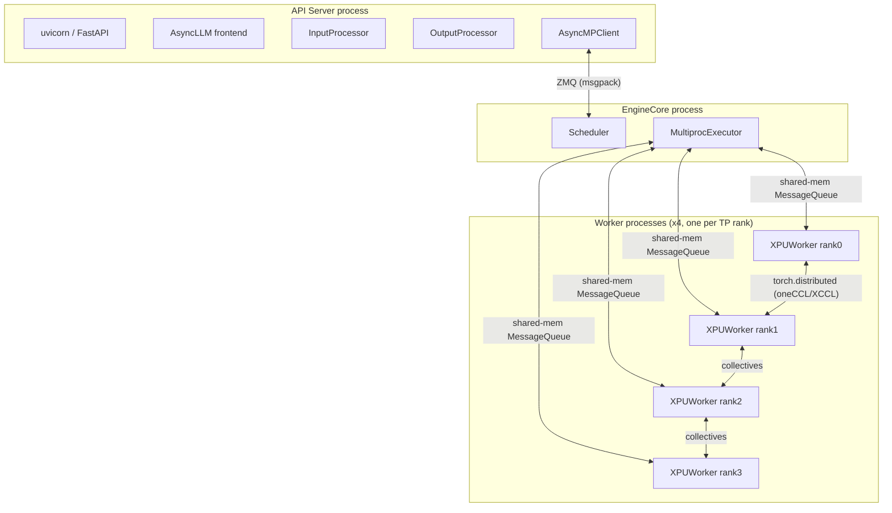

| Link | Transport | Direction / Pattern | Purpose |
|------|-----------|---------------------|---------|
| API ↔ EngineCore | **ZMQ** (`ROUTER`/`PULL`, msgpack) | request/response, async | submit requests, stream outputs |
| EngineCore ↔ Workers | **`MessageQueue`** (`shm_broadcast`) — shared memory for same-node workers, **TCP ZMQ PUB/SUB** fallback for workers on other nodes (see §9a) | 1 writer → N readers (broadcast) + per-worker N → 1 replies | dispatch `collective_rpc` (load_model, execute_model, …) |
| Worker ↔ Worker | **torch.distributed** collectives (oneCCL/XCCL on XPU) | all-reduce / all-gather | tensor-parallel math across the 4 GPUs |

---

## 1. `vllm serve` — CLI Entry & Command Registration

### 1a. The `vllm` executable

`pyproject.toml` registers a console script:

```toml
[project.scripts]
vllm = "vllm.entrypoints.cli.main:main"
```

So `vllm ...` calls `main()` in
[vllm/entrypoints/cli/main.py](vllm/entrypoints/cli/main.py#L16).

### 1b. How `serve` maps to `serve.py`

`main()` builds a static list of CLI modules
([main.py:29](vllm/entrypoints/cli/main.py#L29)) that includes
`vllm.entrypoints.cli.serve`. It then loops over them
([main.py:85](vllm/entrypoints/cli/main.py#L85)):

```python
for cmd_module in CMD_MODULES:
    cmds = cmd_module.cmd_init()               # -> [ServeSubcommand()]
    for cmd in cmds:
        cmd.subparser_init(subparsers).set_defaults(dispatch_function=cmd.cmd)
        cmds[cmd.name] = cmd
...
args.dispatch_function(args)                   # main.py:93
```

- `cmd_init()` in [serve.py:173](vllm/entrypoints/cli/serve.py#L173) returns
  `[ServeSubcommand()]`.
- `ServeSubcommand.name = "serve"`
  ([serve.py:46](vllm/entrypoints/cli/serve.py#L46)).
- `subparser_init` ([serve.py:157](vllm/entrypoints/cli/serve.py#L157)) registers
  the `serve` subparser and attaches all engine args via `make_arg_parser`.
- `set_defaults(dispatch_function=cmd.cmd)` wires the parsed args to
  `ServeSubcommand.cmd`.

When you run `vllm serve`, `args.dispatch_function(args)` therefore calls
`ServeSubcommand.cmd(args)` ([serve.py:48](vllm/entrypoints/cli/serve.py#L48)).

### 1c. `ServeSubcommand.cmd`

For the common single-server path, `cmd` ends with:

```python
uvloop.run(run_server(args))                   # ~serve.py:151
```

(Other branches: `run_headless`, `run_dp_supervisor`, `run_multi_api_server` for
disaggregated / data-parallel / multi-API-server deployments.)

**`uvloop.run` does not create a process or thread.** It installs the uvloop
event-loop policy, creates a **new asyncio event loop on the current thread**, and
runs the `run_server(args)` coroutine to completion on it. All the real
parallelism later comes from separate *processes*, not this call.

---

## 2. `run_server` → Async Engine Client

### 2a. `run_server`

[api_server.py:726](vllm/entrypoints/openai/api_server.py#L726):

- decorates logs, installs a SIGTERM handler,
- calls `setup_server(args)` ([api_server.py:596](vllm/entrypoints/openai/api_server.py#L596)) to build the socket/listener,
- calls `run_server_worker`.

### 2b. `run_server_worker`

[api_server.py:742](vllm/entrypoints/openai/api_server.py#L742):

```python
async with build_async_engine_client(args) as engine_client:
    await build_and_serve(engine_client, ...)   # build_app + init_app_state + serve_http
```

`build_and_serve` builds the FastAPI app (`build_app`
[api_server.py:184](vllm/entrypoints/openai/api_server.py#L184)), wires routes to
the engine (`init_app_state`
[api_server.py:330](vllm/entrypoints/openai/api_server.py#L330)), and starts
uvicorn via `serve_http`.

### 2c. `build_async_engine_client_from_engine_args`

[api_server.py:136](vllm/entrypoints/openai/api_server.py#L136):

```python
vllm_config = engine_args.create_engine_config(...)
engine_client = AsyncLLM.from_vllm_config(vllm_config, ...)
```

---

## 3. `AsyncLLM.from_vllm_config` — Why the Factory, Not `AsyncLLM()`

[async_llm.py:206](vllm/v1/engine/async_llm.py#L206). The frontend is created via a
**factory classmethod**, not by calling `AsyncLLM(...)` directly, because a few
things must be resolved *before* the constructor runs:

```python
@classmethod
def from_vllm_config(cls, vllm_config, ...):
    return cls(
        vllm_config=vllm_config,
        executor_class=Executor.get_class(vllm_config),  # pick executor impl
        log_stats=not vllm_config...disable_log_stats,    # arg translation
        ...
    )
```

- `Executor.get_class(vllm_config)` chooses the executor implementation
  (`MultiprocExecutor` for TP>1). The constructor should not have to know this
  selection logic.
- CLI-style flags (e.g. `disable_log_stats`) are translated into constructor
  kwargs (`log_stats`).
- A sibling factory, `from_engine_args`
  ([async_llm.py:231](vllm/v1/engine/async_llm.py#L231)), first builds the
  `vllm_config` from raw CLI args, then defers to the same path.

Keeping `__init__` "dumb" and putting policy in factories is the standard reason
for this pattern.

---

## 4. `AsyncLLM.__init__` — Frontend Assembly

[async_llm.py:75](vllm/v1/engine/async_llm.py#L75) builds the frontend objects:

```python
self.renderer         = ...                                            # tokenizer/chat rendering
self.input_processor  = InputProcessor(vllm_config, renderer)          # async_llm.py:141
self.output_processor = OutputProcessor(renderer.tokenizer, ...)       # async_llm.py:143
self.engine_core      = EngineCoreClient.make_async_mp_client(...)     # async_llm.py:149
# background task pumping engine outputs -> output_processor
```

### Input Processor vs Output Processor

Both live **inside the API server process** (same process as `AsyncLLM`), not in
the EngineCore. They form the two ends of the request lifecycle:

| | InputProcessor | OutputProcessor |
|---|---|---|
| File | [input_processor.py:38](vllm/v1/engine/input_processor.py#L38) | [output_processor.py:438](vllm/v1/engine/output_processor.py#L438) |
| Direction | user request → engine | engine output → user |
| Core method | `process_inputs(...) -> EngineCoreRequest` ([input_processor.py:255](vllm/v1/engine/input_processor.py#L255)) | `process_outputs(...)` |
| Work | tokenize/preprocess prompt, validate sampling params (`_validate_params` [input_processor.py:90](vllm/v1/engine/input_processor.py#L90)), build `EngineCoreRequest` | detokenize `EngineCoreOutputs`, apply stop strings, build `RequestOutput`, push to the per-request stream |
| State | mostly stateless | keeps `self.request_states` (one `RequestState` per in-flight request, holding detokenizer + output queue) |

`process_inputs_async` ([input_processor.py:77](vllm/v1/engine/input_processor.py#L77))
runs tokenization on the renderer's **thread pool** so the event loop is not
blocked by CPU-bound tokenization.

---

## 5. `EngineCoreClient.make_async_mp_client` — The ZMQ Client

[core_client.py:106](vllm/v1/engine/core_client.py#L106). Returns:

- `DPAsyncMPClient` / `DPLBAsyncMPClient` when data-parallel > 1,
- otherwise **`AsyncMPClient`** ([core_client.py:981](vllm/v1/engine/core_client.py#L981)).

### 5a. What `AsyncMPClient` / `MPClient` do

`MPClient.__init__` sets up the API↔EngineCore ZMQ layer and **spawns the
EngineCore process**:

- creates `zmq.asyncio.Context`, an `input_socket` (`ROUTER`, bound) and an
  `output_socket` (`PULL`),
- `launch_core_engines(...)` — starts the EngineCore process,
- a readiness handshake loop bounded by `VLLM_ENGINE_READY_TIMEOUT_S`,
- `_apply_ready_response` — syncs values discovered by the engine back into the
  frontend config (e.g. `max_model_len`, `num_gpu_blocks`, `block_size`),
- `start_engine_core_monitor` — a daemon thread that detects engine death.

`AsyncMPClient.__init__` ([core_client.py:981](vllm/v1/engine/core_client.py#L981)):

```python
super().__init__(asyncio_mode=True, ...)
self.outputs_queue = asyncio.Queue()          # core_client.py:999
self._ensure_output_queue_task()
```

### 5b. What `outputs_queue` does

It is an in-process `asyncio.Queue` in the API server that **receives generation
outputs sent by EngineCore over ZMQ**. It decouples the ZMQ receive loop from
`AsyncLLM._run_output_handler`, which consumes the queue and routes each output
to the corresponding `generate` call.

- `_ensure_output_queue_task` ([core_client.py:1019](vllm/v1/engine/core_client.py#L1019))
  starts a background task `process_outputs_socket` that loops:
  `output_socket.recv_multipart()` → `decoder.decode(...)` →
  - utility RPC replies resolve their `Future` (`_process_utility_output`),
  - generation outputs go to `outputs_queue.put_nowait(outputs)`,
  - exceptions are also placed on the queue so consumers can re-raise them.
- `get_output_async` ([core_client.py:1097](vllm/v1/engine/core_client.py#L1097))
  does `await self.outputs_queue.get()` and re-raises if the item is an exception.

### 5c. Sending requests

- `add_request_async` ([core_client.py:1160](vllm/v1/engine/core_client.py#L1160)):
  `_send_input(EngineCoreRequestType.ADD, request)` →
  `input_socket.send_multipart((engine,) + message, copy=False)`.
- `call_utility_async` ([core_client.py:1140](vllm/v1/engine/core_client.py#L1140)):
  Future-based RPC for control-plane calls.

### 5d. Request/output round-trip

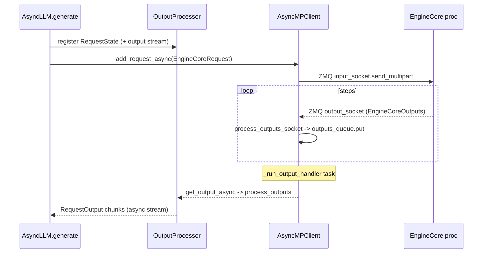

### 5e. `launch_core_engines` — spawning & handshaking the EngineCore process(es)

[utils.py:1070](vllm/v1/engine/utils.py#L1070). Called from inside `MPClient.__init__`
(section 5a), this is a `@contextlib.contextmanager` that does the actual process
spawn and blocks until every EngineCore is confirmed `READY` — it is the thing that
makes `launch_core_engines(...)` in `MPClient.__init__` a synchronous "wait for the
engine(s) to fully boot" call.

**Before yielding** (setup phase):

1. Optionally creates a `tensor_queue` (multiprocessing `Queue`) for multimodal
   tensor IPC, if `mm_tensor_ipc == "torch_shm"`.
2. If this is a DP deployment needing coordination (`needs_dp_coordinator`) and this
   is `dp_rank == 0` and not offline mode, starts a **`DPCoordinator`** process and
   wires its ZMQ addresses into `addresses.coordinator_input/output`. Not applicable
   for your DP=1 run.
3. Branches on `parallel_config.data_parallel_backend == "ray"` → `CoreEngineActorManager`
   (Ray actors instead of raw processes) — not your path.
4. Builds `engines_to_handshake: list[CoreEngine]` — one tracker per DP rank this
   process needs to hear a `READY` from (just 1, for DP=1).
5. Opens a ZMQ `ROUTER` **handshake socket** (`zmq_socket_ctx(local_handshake_address, zmq.ROUTER, bind=True)`).
6. If `local_engine_count > 0`, constructs **`CoreEngineProcManager`**
   ([utils.py:120](vllm/v1/engine/utils.py#L120)) — this is what actually does:
   ```python
   context.Process(target=EngineCoreProc.run_engine_core, kwargs=common_kwargs | {...})
   ...
   proc.start()   # <-- the EngineCore process is forked/spawned here
   ```
   one process per local DP rank (just 1 for TP=4/DP=1).

**`yield CoreEngineLaunch(...)`** — control briefly returns to the caller
(`MPClient.__init__`) with the manager/coordinator/addresses packaged up, so the
caller can stash references (e.g. watched frontend processes) before the handshake
wait begins.

**After the `with` block resumes** (on context-manager exit, i.e. after the caller's
`yield` returns):

```python
wait_for_engine_startup(handshake_socket, engines_to_handshake, parallel_config, ...)
```

[utils.py:1181](vllm/v1/engine/utils.py#L1181) drives a `zmq.Poller` loop registered
on: the handshake socket, each spawned process's `sentinel` (so a crashed EngineCore
is detected immediately instead of hanging), the coordinator's sentinel if present,
and any watched frontend process sentinels. For each `(HELLO, READY)` message pair
received per engine:

1. `HELLO` (state `NEW→CONNECTED`): front-end replies with an `EngineHandshakeMetadata`
   payload (ZMQ addresses + relevant `parallel_config` fields) — this is the same
   handshake consumed by `EngineCoreProc._perform_handshakes`/`startup_handshake`
   (section 6).
2. `READY` (state `CONNECTED→READY`): for coordinated DP models, validates the
   worker's `parallel_config_hash` matches this process's, to catch mismatched
   `--` flags across DP ranks.

The loop (and therefore `launch_core_engines`, and therefore `MPClient.__init__`,
and therefore `AsyncLLM.from_vllm_config`) doesn't return until **all** tracked
engines reach `READY` — so by the time the API server starts accepting HTTP
requests, every EngineCore process (and transitively every worker process inside
it, per section 7's `wait_for_ready`) is fully initialized.

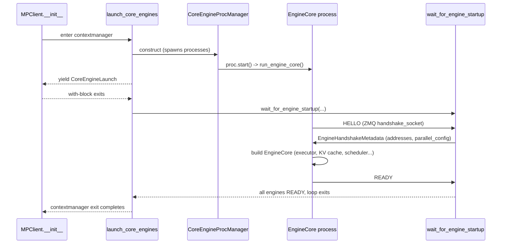

### 5f. What the API server does after EngineCore is ready

After the startup handshake completes, the API-server process starts Uvicorn and
its asyncio event loop concurrently manages several long-lived tasks:

- Uvicorn's `server.serve(...)` task waits for HTTP connections and runs a
  FastAPI request-handler coroutine for each request.
- `AsyncMPClient.process_outputs_socket` waits in
  `await output_socket.recv_multipart(...)` for ZMQ messages from EngineCore,
  decodes them, and places generation results into the API-server-local
  `outputs_queue`.
- `AsyncLLM._run_output_handler` calls `get_output_async()`, which executes
  `await self.outputs_queue.get()`. If the queue is empty, only this coroutine is
  suspended; the event loop remains free to serve HTTP requests and run other
  tasks. When an item arrives, `get()` removes and returns the next
  `EngineCoreOutputs` item. It does **not** itself reply to an HTTP client.
- The watchdog task periodically checks whether the engine has failed.

The output handler passes each returned `EngineCoreOutputs` batch to
`OutputProcessor`, which routes every per-request result by `request_id` into its
`RequestOutputCollector`. The corresponding `AsyncLLM.generate` coroutine reads
that collector and yields `RequestOutput` objects. Only the OpenAI serving layer
then serializes those objects and writes SSE chunks or a final JSON response to
the HTTP client.

For chat completions, the invocation chain is:

```text
HTTP client
  -> FastAPI create_chat_completion route
  -> OpenAIServingChat.create_chat_completion
  -> OpenAIServingChat._create_chat_completion
  -> self.engine_client.generate(...)          # AsyncLLM.generate
```

Because `AsyncLLM.generate` is an async generator, calling it first creates a
generator object. Its body runs when the serving layer iterates it: the streaming
path iterates it from `chat_completion_stream_generator`, while the non-streaming
path iterates it from `chat_completion_full_generator`.

When there are no requests or engine outputs, the API-server process is therefore
mostly idle with multiple coroutines independently suspended on their own waits:

```text
Uvicorn server task -------- awaits incoming HTTP
process_outputs_socket ----- awaits EngineCore ZMQ output
AsyncLLM output_handler ---- awaits outputs_queue.get()
watchdog ------------------- sleeps until its next health check
```

The asyncio event loop resumes whichever task becomes ready; the entire process
does not block exclusively on `process_outputs_socket` or `outputs_queue.get()`.

---

## 6. EngineCore Process

`EngineCore.__init__` ([core.py:107](vllm/v1/engine/core.py#L107)) is the heart of
the engine process:

```python
self.model_executor = executor_class(vllm_config)   # core.py:133  <-- spawns workers
self._initialize_kv_caches(...)                      # core.py:144 / 253
self.scheduler = Scheduler(...)
# batch_queue setup, freeze_gc_heap()
```

- `_initialize_kv_caches` ([core.py:253](vllm/v1/engine/core.py#L253)):
  `get_kv_cache_specs` → `determine_available_memory`
  ([core.py:296](vllm/v1/engine/core.py#L296)) → `get_kv_cache_configs` →
  `initialize_from_config` ([core.py:329](vllm/v1/engine/core.py#L329)) →
  `compile_or_warm_up_model` ([core.py:331](vllm/v1/engine/core.py#L331)). Each of
  these fans out to the workers via `self.collective_rpc(...)`.
- The steady-state loop `step` (~core.py:575):
  `scheduler.schedule()` → `model_executor.execute_model(..., non_block=True)` →
  `sample_tokens` → `scheduler.update_from_output`.

`EngineCoreProc(EngineCore)` (~core.py:1000) is the ZMQ wrapper that runs
`EngineCore` in the background process: it has `input_queue`/`output_queue` thread
queues, `_perform_handshakes`, `process_input_sockets` / `process_output_sockets`
daemon threads, and the `run_engine_core` static busy loop.

---

## 7. `executor_class(vllm_config)` — Spawning the 4 Worker Processes

The line `self.model_executor = executor_class(vllm_config)`
([core.py:133](vllm/v1/engine/core.py#L133)) constructs a **`MultiprocExecutor`**
(the class chosen by `Executor.get_class` for TP>1).

### 7a. Base constructor → subclass hook

`Executor.__init__` ([abstract.py:96](vllm/v1/executor/abstract.py#L96)) stores
sub-configs and calls the abstract hook:

```python
self.parallel_config = vllm_config.parallel_config
...
self._init_executor()          # overridden by MultiprocExecutor
```

### 7b. `MultiprocExecutor._init_executor`

[multiproc_executor.py:118](vllm/v1/executor/multiproc_executor.py#L118):

1. **Sizes & envs**

   ```python
   tp_size, pp_size, pcp_size = self._get_parallel_sizes()   # 4,1,1
   assert self.world_size == tp_size * pp_size * pcp_size     # 4
   set_multiprocessing_worker_envs(self.local_world_size)
   ```

2. **Broadcast channel** (executor → all workers)

   ```python
   self.rpc_broadcast_mq = MessageQueue(self.world_size, self.local_world_size, ...)  # L161
   scheduler_output_handle = self.rpc_broadcast_mq.export_handle()                     # L167
   ```

3. **Spawn loop — one process per rank**

   ```python
   context = get_mp_context()            # "spawn" on XPU
   for local_rank in range(self.local_world_size):   # 0..3
       global_rank = global_start_rank + local_rank
       unready = WorkerProc.make_worker_process(
           vllm_config, local_rank, rank=global_rank,
           distributed_init_method,
           input_shm_handle=scheduler_output_handle,   # attach to broadcast mq
           shared_worker_lock,
           is_driver_worker=self._is_driver_worker(global_rank),
           inherited_fds=inherited_fds,
       )
       unready_workers.append(unready)
   ```

4. **The actual OS spawn** — `WorkerProc.make_worker_process`
   ([multiproc_executor.py:702](vllm/v1/executor/multiproc_executor.py#L702)):

   ```python
   ready_reader, ready_writer = context.Pipe(duplex=False)   # child -> parent "READY"
   death_reader, death_writer = context.Pipe(duplex=False)   # parent-exit detector
   proc = context.Process(
       target=WorkerProc.worker_main,   # child entry point
       kwargs=process_kwargs,           # incl. input_shm_handle, pipes
       name=f"VllmWorker-{rank}",
       daemon=True,
   )
   proc.start()                         # <-- process created here
   return UnreadyWorkerProcHandle(proc, rank, ready_reader, death_writer)
   ```

   XPU forces the **spawn** start method, so each child is a fresh interpreter
   (not a fork).

5. **Child body** — `WorkerProc.worker_main`
   ([multiproc_executor.py:850](vllm/v1/executor/multiproc_executor.py#L850)):
   installs signal handlers, closes inherited fds, constructs the `WorkerProc`
   (which builds the real **`XPUWorker`**, calls `init_device()` — selects the XPU
   device and initializes the oneCCL/XCCL process group via
   `distributed_init_method`), attaches to `rpc_broadcast_mq` through
   `input_shm_handle`, creates its own `worker_response_mq`, signals `"READY"` on
   the ready pipe, then enters `worker_busy_loop`
   ([multiproc_executor.py:1026](vllm/v1/executor/multiproc_executor.py#L1026)).

6. **Wait for readiness & wire replies**

   ```python
   self.workers = WorkerProc.wait_for_ready(unready_workers)   # L213
   self.response_mqs = [ w.worker_response_mq for w in ... ]   # L228
   self.rpc_broadcast_mq.wait_until_ready()                    # L243
   for mq in self.response_mqs: mq.wait_until_ready()
   ```

   `wait_for_ready` ([multiproc_executor.py:776](vllm/v1/executor/multiproc_executor.py#L776))
   blocks on all ready pipes until every worker reports `"READY"` and hands back
   its response-queue handle. Workers are **created before** waiting on purpose —
   `init_device()` does a device sync, so waiting first would deadlock.

### 7c. Spawn timeline

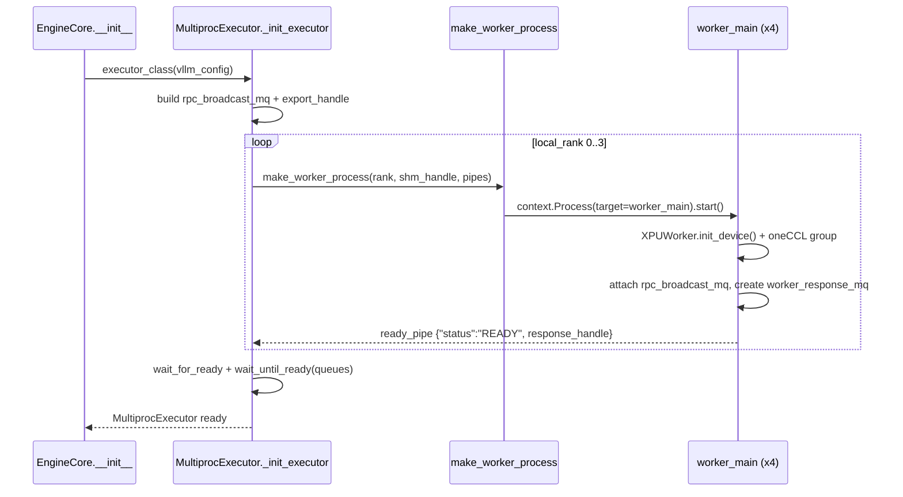

### 7d. How a spawned process actually builds `XPUWorker`

Each child process runs `WorkerProc.worker_main`
([multiproc_executor.py:850](vllm/v1/executor/multiproc_executor.py#L850)). The
line that constructs the real worker is:

```python
worker = WorkerProc(*args, **kwargs)          # multiproc_executor.py:908
```

The concrete `XPUWorker` type is **never named** in the executor — it is resolved
by string, dynamically, in three hops:

1. **`WorkerProc.__init__` builds a generic wrapper**
   ([multiproc_executor.py:637](vllm/v1/executor/multiproc_executor.py#L637)):

   ```python
   wrapper = WorkerWrapperBase(rpc_rank=local_rank, global_rank=rank)
   all_kwargs[local_rank] = {
       "vllm_config": vllm_config, "local_rank": local_rank, "rank": rank,
       "distributed_init_method": distributed_init_method,
       "is_driver_worker": is_driver_worker, "shared_worker_lock": shared_worker_lock,
   }
   wrapper.init_worker(all_kwargs)     # <-- XPUWorker instantiated here
   self.worker = wrapper
   ```

   `WorkerProc` is platform-agnostic; it delegates to `WorkerWrapperBase`
   ([worker_base.py:191](vllm/v1/worker/worker_base.py#L191)), a thin lazy
   initializer.

2. **`WorkerWrapperBase.init_worker` resolves the class by qualified name**
   ([worker_base.py:234](vllm/v1/worker/worker_base.py#L234)):

   ```python
   if isinstance(parallel_config.worker_cls, str):
       worker_class = resolve_obj_by_qualname(parallel_config.worker_cls)
   ...
   with set_current_vllm_config(self.vllm_config):
       self.worker = worker_class(**kwargs)     # worker_base.py:322
   ```

   - `parallel_config.worker_cls` is the string
     `"vllm.v1.worker.xpu_worker.XPUWorker"`.
   - `resolve_obj_by_qualname(...)` imports the module and returns the class.
   - `worker_class(**kwargs)` finally constructs the `XPUWorker` instance.

3. **Where `worker_cls` became `XPUWorker`** — set earlier by the platform during
   config finalization, [xpu.py:356](vllm/platforms/xpu.py#L356):

   ```python
   # Only override worker_cls if it's still the default "auto"
   if parallel_config.worker_cls == "auto":
       parallel_config.worker_cls = "vllm.v1.worker.xpu_worker.XPUWorker"
   ```

   `XPUPlatform.check_and_update_config` runs while building `vllm_config` (in
   `create_engine_config`, long before workers spawn). That `vllm_config` is
   shipped into every child via `process_kwargs`, so all 4 ranks resolve the same
   class.

**After construction**, still inside `WorkerProc.__init__`, the worker is brought
online:

```python
self.worker.init_device()   # select XPU device, init oneCCL/XCCL process group
self.worker.load_model()    # load Kimi-Linear weights onto the device
```

Then `_init_message_queues(...)` attaches the worker to `rpc_broadcast_mq` (via
`input_shm_handle`) and creates its `worker_response_mq`. Only then does
`worker_main` send `{"status": "READY", ...}` on the ready pipe and enter
`worker_busy_loop`.

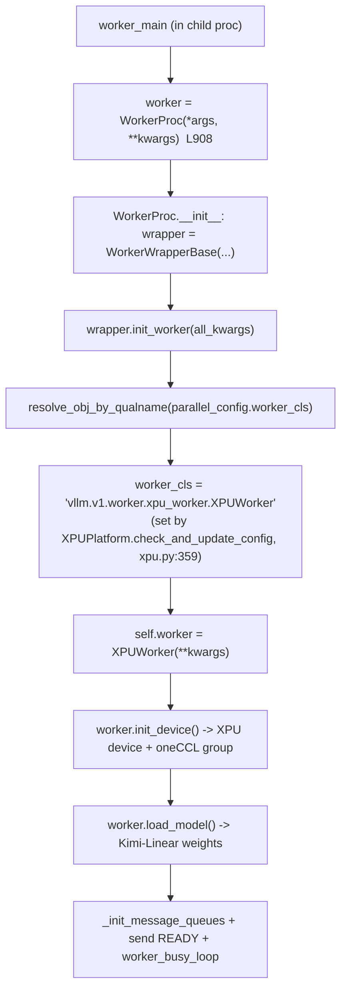

| Layer | Class | Role | File |
|-------|-------|------|------|
| Process shell | `WorkerProc` | manages the OS process, queues, ready/death pipes | [multiproc_executor.py:597](vllm/v1/executor/multiproc_executor.py#L597) |
| Generic initializer | `WorkerWrapperBase` | lazily resolves + builds the platform worker | [worker_base.py:191](vllm/v1/worker/worker_base.py#L191) |
| Concrete worker | `XPUWorker` | actual device init, model load, `execute_model` | `vllm/v1/worker/xpu_worker.py` |

**Key point:** line 908 builds a `WorkerProc`, which builds a `WorkerWrapperBase`,
which reads `parallel_config.worker_cls` (`"…xpu_worker.XPUWorker"`, set by the XPU
platform) and dynamically imports/instantiates `XPUWorker`, then immediately calls
`init_device()` and `load_model()` to bring it up.

---

## 8. Memory Snapshot & `_initialize_kv_caches`

After the executor is up (all 4 workers `READY`), `EngineCore.__init__` calls
`_initialize_kv_caches` ([core.py:253](vllm/v1/engine/core.py#L253)). This is the
orchestration layer — it runs in the **EngineCore process** but every heavy step is
a `collective_rpc` broadcast that the **workers** actually execute on their XPUs.

### 8a. The initial memory snapshot (taken by each worker, earlier)

The baseline snapshot is **not** taken by EngineCore — it is taken by each
`XPUWorker` during `init_device()` (i.e. at spawn time, before any RPC), at
[xpu_worker.py:118](vllm/v1/worker/xpu_worker.py#L118):

```python
# Now take memory snapshot after NCCL is initialized
gc.collect()
torch.accelerator.empty_cache()
self.init_snapshot = init_snapshot = MemorySnapshot(device=self.device)   # baseline
self.requested_memory = request_memory(init_snapshot, self.cache_config)
```

- Taken **after** distributed init + oneCCL warm-up all-reduce and **after**
  `gc.collect()` / `empty_cache()`, so it reflects a clean baseline of free memory
  **before** the model weights are loaded.
- `EngineCore` has no device and no model, so it can never take this snapshot —
  it only later receives the aggregated result over the response queue.

**`request_memory`** ([utils.py:444](vllm/v1/worker/utils.py#L444)) just computes
the overall budget and validates it:

$$\text{requested\_memory} = \lceil \text{total\_memory} \times \text{gpu\_memory\_utilization} \rceil$$

If `free_memory < requested_memory` at startup it raises (another process is
already using the card). Note `requested_memory` is a fraction of **total**, not
free. It is only the *ceiling* — actual KV-cache sizing happens later.

### 8b. `_initialize_kv_caches` — four phases

```python
def _initialize_kv_caches(self, vllm_config):
    register_all_kvcache_specs(vllm_config)
    kv_cache_specs = self.model_executor.get_kv_cache_specs()          # (1) specs
    ...
    available_gpu_memory = self.model_executor.determine_available_memory()  # (2) profile
    ...
    kv_cache_configs = get_kv_cache_configs(vllm_config, kv_cache_specs, available_gpu_memory)
    ...
    self.model_executor.initialize_from_config(kv_cache_configs)       # (3) allocate
    self.model_executor.compile_or_warm_up_model()                     # (4) warmup+capture
```

**Phase 1 — Collect KV cache specs.** `get_kv_cache_specs()` RPCs every worker for
its per-layer KV memory needs (dtype, heads, head size, block size). The engine
also checks for `non_causal` layers here and, if found, **disables chunked prefill
and prefix caching** (they assume causal attention). Attention-free models skip
all profiling (`available_gpu_memory = [0]`).

**Phase 2 — Memory profiling (the profiling run).** `determine_available_memory()`
RPCs each worker's `determine_available_memory`
([gpu_worker.py:475](vllm/v1/worker/gpu_worker.py#L475)):

```python
with memory_profiling(self.init_snapshot,
                      weights_memory=int(self.model_runner.model_memory_usage)) as profile_result:
    self.model_runner.profile_run()        # dummy worst-case forward pass
# context exit -> after_profile snapshot captured
self.available_kv_cache_memory_bytes = (
    self.requested_memory - profile_result.non_kv_cache_memory - cudagraph_memory_estimate_applied
)
```

- **Starts** when entering `memory_profiling(...)` and calling `profile_run()`
  (a dummy forward at the largest batch / `max_num_batched_tokens`).
- **Ends** when the `with` block exits and takes the `after_profile` snapshot.
- **Why:** you can't size the KV cache until you know the **peak transient
  activation memory** of a worst-case forward. The available KV memory is:

  $$\text{available\_kv} = \text{requested\_memory} - \text{non\_kv\_cache\_memory} - \text{cudagraph\_estimate}$$

  where `non_kv_cache_memory` = weights + non-torch + peak activations.
- **XPU note:** the *graph-memory estimate* is CUDA/ROCm-only. Its call site is
  gated on `current_platform.is_cuda_alike()`
  ([gpu_worker.py:529](vllm/v1/worker/gpu_worker.py#L529)), so `profile_cudagraph_memory()`
  is **never called** on XPU and `cudagraph_memory_estimate = 0` on the B70. This is
  only about *pre-reserving* graph memory — it does **not** mean XPU lacks graphs
  (see Phase 4). The estimator is disabled on XPU because its allocator-pool /
  free-memory-delta primitives are not yet validated there (issue #39977).
- A safety `assert self.init_snapshot.free_memory >= free_gpu_memory` guards
  against another process freeing memory mid-profiling.

**Phase 3 — Turn bytes into blocks and allocate.** `get_kv_cache_configs` converts
available bytes → **number of blocks** and groups layers; the engine sets
`num_gpu_blocks` / `block_size`. If profiling forced a smaller `max_model_len`
(auto-fit), the engine RPCs `update_max_model_len` (workers cached the old value at
spawn). Then `initialize_from_config` ([gpu_worker.py:665](vllm/v1/worker/gpu_worker.py#L665))
is the RPC where each worker **physically allocates** the KV cache tensors
(`model_runner.initialize_kv_cache`) and any KV-transfer connector.

**Phase 4 — Warmup + graph capture.** `compile_or_warm_up_model`
([gpu_worker.py:694](vllm/v1/worker/gpu_worker.py#L694)) runs, in order:

```python
for size in sorted(warmup_sizes, reverse=True):
    self.model_runner._dummy_run(size, ...)   # 1. torch.compile warmup for hot shapes
kernel_warmup(self)                           # 2. tune kernels BEFORE capture
if not self.model_config.enforce_eager:
    cuda_graph_memory_bytes = self.model_runner.capture_model()   # 3. GRAPH CAPTURE
```

- **Graph capture starts** in `capture_model()` — **only after** KV allocation,
  torch.compile warmup, and kernel tuning, because the captured graph must
  reference the *real* KV tensors and *final* kernels.
- **XPU does capture graphs.** `capture_model()` records real `torch.xpu.XPUGraph`
  objects: `_torch_cuda_wrapper` in
  [xpu_model_runner.py:41](vllm/v1/worker/xpu_model_runner.py#L41) aliases the XPU
  graph primitives (`torch.cuda.CUDAGraph = torch.xpu.XPUGraph`,
  `graph_pool_handle`, …) onto the names the shared `capture_model` path uses.
- Capture happens **iff** `cudagraph_mode != NONE` **and** not `--enforce-eager`.
  The XPU platform sets `cudagraph_mode` in `check_and_update_config`
  ([xpu.py:280](vllm/platforms/xpu.py#L280)): it is forced to `NONE` if the torch
  build lacks XPU-graph support (`supports_xpu_graph()`) or if
  `VLLM_XPU_ENABLE_XPU_GRAPH=1` is not set; otherwise real XPU-graph capture runs.
- Net effect on XPU: graphs are captured but their memory is **not** pre-reserved
  (estimate = 0), so `capture_model()` allocates XPU-graph memory on top of the KV
  budget — the reason the estimator stays disabled there (#39977).
- **Replay has an XPU-specific host-side serialization point.** PyTorch's
  `XPUGraphImpl::replay()` only calls `queue.ext_oneapi_graph(*graph_exec_)`; it
  contains no explicit host wait. The wait is one layer lower in the SYCL
  Unified Runtime Level Zero adapter. When the same command-buffer object is
  submitted again, the adapter calls `zeEventHostSynchronize` on that object's
  preceding execution event before appending it again. See the
  [v2 `appendCommandBufferExp` implementation](https://github.com/intel/llvm/blob/sycl/unified-runtime/source/adapters/level_zero/v2/command_list_manager.cpp#L636-L661)
  and the
  [v1 `waitForOngoingExecution` implementation](https://github.com/intel/llvm/blob/sycl/unified-runtime/source/adapters/level_zero/command_buffer.cpp#L681-L699).
  This is not a device-wide synchronization: it serializes consecutive
  submissions of that particular captured graph.
- **The captured graph covers only the model forward.** In the model runner,
  `_prepare_inputs()`/`_preprocess()` run before `_model_forward()`, while logits
  processing and other postprocessing run after it; sampling is performed later
  by `sample_tokens()`. For this Kimi-Linear model with PP=1, the forward itself
  is the token-embedding layer followed by the complete stack of $N$ model
  layers (and the model's final output transformations where applicable):

  ```text
  forward = embedding -> model layer 0 -> ... -> model layer N-1
  ```

  The embedding is created on the first PP rank and the layer loop covers
  `layers[start_layer:end_layer]`; because PP=1, that is the full layer stack on
  every TP worker. Logits computation and sampling are outside this boundary.
  Consequently, preprocess, postprocess, and sampling GPU operations are not
  part of the replayed command buffer and are not directly subject to its
  same-command-buffer host wait.

#### The three warmup steps are independent

The `if mode == VLLM_COMPILE` guard (step 1) only governs the `torch.compile`
warmup loop. `kernel_warmup` (step 2) and `capture_model` (step 3) run regardless
of the compilation mode:

| Step | Guard | What it is |
|------|-------|-----------|
| 1. `_dummy_run(size)` loop | `mode == CompilationMode.VLLM_COMPILE` | `torch.compile` (Inductor) warmup: traces + splits the graph, generates/autotunes **Triton** kernels for fusible regions, and compiles the C++/host glue for each hot shape. Library GEMMs (cuBLAS/oneDNN) and vLLM custom ops (`splitting_ops`) are left as-is. `warmup_sizes` starts empty, so if `mode != VLLM_COMPILE` (the typical XPU / `--enforce-eager` case) the loop body never runs. |
| 2. `kernel_warmup(self)` | always called | Pre-triggers **JIT'ed** kernels (mostly Triton, plus CuTe-DSL / DeepGEMM / FlashInfer autotune) so JIT never happens on the first real request. Not `torch.compile`. |
| 3. `capture_model()` | `not enforce_eager` | Real graph capture (`XPUGraph` on XPU). |

#### `kernel_warmup` for Kimi-Linear on XPU

`kernel_warmup` ([kernel_warmup.py:100](vllm/model_executor/warmup/kernel_warmup.py#L100))
is a **dispatcher** whose sub-warmups are each gated by hardware capability or model
family. On the **B70 + Kimi-Linear** run, almost every branch is a **no-op**:

| Sub-warmup | Gate | B70 / Kimi-Linear |
|------------|------|-------------------|
| `warm_v1_block_table_kernels` + KV-block zeroer | `not use_v2_model_runner` | runs only on the V1 runner |
| `qwen_triton_warmup` | Qwen models | no-op |
| `deepseek_v4_mhc_warmup` | DSv4 | no-op |
| `kimi_k3_triton_warmup` | `enable_jit_warmup` + an **`nvidia.kda.KimiK3DeltaAttention`** layer | **no-op on XPU** (see below) |
| `fa4_cutedsl_warmup`, `sparse_mla_triton_warmup` | `enable_jit_warmup` + CUDA CuTe-DSL/MLA | no-op |
| `_warmup_ll_bf16_router_gemm` | `has_device_capability(90)` (Hopper) | no-op (XPU has no SM cap) |
| `cutedsl_warmup` | `enable_cutedsl_warmup` (CUDA) | no-op |
| flashinfer sparse-MLA / `deep_gemm_warmup` / `flashinfer_autotune` | FlashInfer / DeepGEMM / cap 90 | no-op (CUDA libs) |
| `b12x_warmup`, `minimax_m3_msa_warmup` | model gates | no-op |

**Why `kimi_k3_triton_warmup` skips on XPU.** `_get_kda_layer`
([kimi_k3_triton_warmup.py:20](vllm/model_executor/warmup/kimi_k3_triton_warmup.py#L20))
imports the **NVIDIA** attention class and `isinstance`-checks the model's static
forward context against it:

```python
from vllm.models.kimi_k3.nvidia.kda import KimiK3DeltaAttention
...
return next((layer for layer in static_context.values()
             if isinstance(layer, KimiK3DeltaAttention)), None)
```

On XPU the model builds `KimiLinearDeltaAttention(XPUKimiGatedDeltaNetAttention)`
from [kimi_k3/xpu/kda.py:112](vllm/models/kimi_k3/xpu/kda.py#L112) — a **different
class tree** (`xpu.kda`, not `nvidia.kda`). The `isinstance` fails, `_get_kda_layer`
returns `None`, and the warmup returns early. (`_warm_attn_res` also hardcodes
`device = torch.device("cuda")`, confirming it is CUDA-only.)

**Consequence.** On XPU, `kernel_warmup` is effectively **near-empty** for
Kimi-Linear — at most the generic V1 block-table / KV-zeroing kernels run. The KDA
linear-attention Triton kernels (`chunk_gated_delta` / `fused_recurrent`-style ops
in the `xpu.kda` path) are **not** pre-warmed here; they JIT-compile lazily on the
**first real forward** (or inside the `capture_model()` dummy runs). There is
currently no XPU-specific warmup entry analogous to `kimi_k3_triton_warmup` wired
into `kernel_warmup` — a known XPU-enablement gap.

### 8c. Ordering rule

**profile → allocate KV → warmup/compile → capture graphs.** Profiling must
precede allocation (cache is sized from the measured peak); capture must come last
(graphs reference real KV tensors + tuned kernels). EngineCore only sequences
these; the workers do all device work.

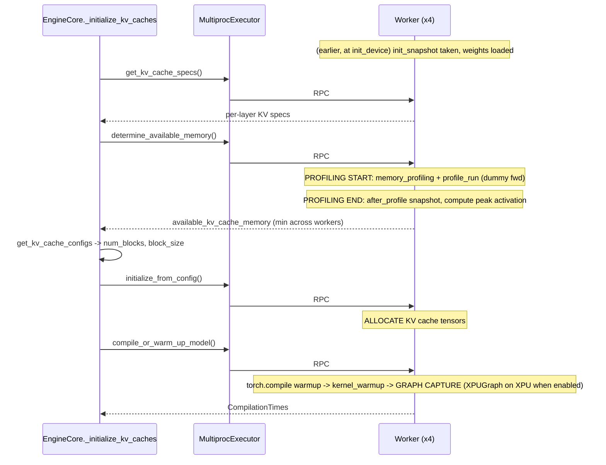

| Event | Code | Executed by | Why |
|-------|------|-------------|-----|
| `init_snapshot` baseline | [xpu_worker.py:118](vllm/v1/worker/xpu_worker.py#L118) | worker | free memory before weights |
| `requested_memory` budget | [utils.py:444](vllm/v1/worker/utils.py#L444) | worker | `total × util` ceiling |
| Profiling run start/end | [gpu_worker.py:514](vllm/v1/worker/gpu_worker.py#L514) | worker | measure peak activation of worst-case batch |
| KV cache allocation | [gpu_worker.py:665](vllm/v1/worker/gpu_worker.py#L665) | worker | physically allocate blocks |
| torch.compile warmup | [gpu_worker.py:722](vllm/v1/worker/gpu_worker.py#L722) | worker | pre-compile hot shapes |
| Kernel tuning | [gpu_worker.py:728](vllm/v1/worker/gpu_worker.py#L728) | worker | fix kernels before capture |
| Graph capture start | [gpu_worker.py:732](vllm/v1/worker/gpu_worker.py#L732) | worker | replayable graphs; XPU uses `XPUGraph` (when `VLLM_XPU_ENABLE_XPU_GRAPH=1` + supported); skipped if `--enforce-eager` |

---

## 9. EngineCore ↔ Workers Transport (`collective_rpc`)

Once workers are up, every model operation is a broadcast:

`MultiprocExecutor.collective_rpc`
([multiproc_executor.py:372](vllm/v1/executor/multiproc_executor.py#L372)):

```python
self.rpc_broadcast_mq.enqueue((send_method, args, kwargs, output_rank))  # 1 -> N
# read replies from self.response_mqs                                    # N -> 1
```

- `rpc_broadcast_mq` — **1 writer (executor) → N readers (workers)**, shared memory.
- `worker_response_mq` (per worker) — **N → 1**, replies flow back to the executor.
- `unique_reply_rank` / `output_rank` lets a call collect a reply from a single
  rank instead of all four.

Each worker's `worker_busy_loop` dequeues `(method, args, kwargs)` and runs it
(`load_model`, `determine_available_memory`, `execute_model`, `compile_or_warm_up_model`,
…). Tensor-parallel math *inside* those methods uses **torch.distributed
collectives** (oneCCL/XCCL) directly between the 4 worker processes — a separate
channel from the shared-memory queues.

### 9a. Crossing the node boundary — `MessageQueue` is a hybrid transport

`MessageQueue` ([shm_broadcast.py:464](vllm/distributed/device_communicators/shm_broadcast.py#L464))
is **not** pure shared memory — it is a hybrid that uses SHM for same-node readers
and falls back to **ZMQ PUB/SUB over TCP** for readers on other nodes. The split is
decided once, at construction, from `n_reader` (total) vs `n_local_reader`
(same-node):

```python
n_remote_reader = n_reader - n_local_reader
if n_local_reader > 0:
    self.buffer = ShmRingBuffer(n_local_reader, ...)   # shared memory ring buffer
    self.local_socket = context.socket(XPUB)           # ipc:// socket for overflow/large payloads
if n_remote_reader > 0:
    self.remote_socket = context.socket(XPUB)
    self.remote_socket.bind(f"tcp://{connect_ip}:0")    # <-- real network socket
```

`enqueue()` ([shm_broadcast.py:823](vllm/distributed/device_communicators/shm_broadcast.py#L823))
writes to **both** channels when both exist: local readers get the SHM ring
buffer, remote readers get `remote_socket.send_multipart(...)` over TCP. Each
reader is told which channel to use via `local_reader_ranks` in the `Handle` it is
created from — if its rank is listed, it attaches to SHM + local `ipc://` socket;
otherwise it only connects the TCP `remote_socket`.

**Where the split happens in the executor:**

- **Broadcast direction (EngineCore → workers)**: the leader-node
  `rpc_broadcast_mq` is built with `n_local_reader=self.local_world_size` and
  `connect_ip=get_ip()` ([multiproc_executor.py:161](vllm/v1/executor/multiproc_executor.py#L161));
  workers on other nodes simply become "remote readers" that subscribe via TCP
  instead of SHM.
- **Response direction (workers → EngineCore)**:
  [multiproc_executor.py:599](vllm/v1/executor/multiproc_executor.py#L599) branches on
  `nnodes_within_dp`:
  - `== 1` (single node, our XPU/TP=4 case): `worker_response_mq = MessageQueue(1, 1)`
    — pure local SHM.
  - `> 1` (multi-node): the response queues are built via
    `get_inner_dp_world_group().create_mq_broadcaster(...)` /
    `create_single_reader_mq_broadcasters(...)`
    ([parallel_state.py:557](vllm/distributed/parallel_state.py#L557)), which call
    `create_from_process_group` ([shm_broadcast.py:977](vllm/distributed/device_communicators/shm_broadcast.py#L977)).
    This uses `in_the_same_node_as(pg, source_rank)` to partition the
    torch.distributed process group into same-node vs different-node members and
    constructs the `MessageQueue` with the right local/remote split
    automatically. The executor ends up with a `response_mqs` list where local
    ranks map to plain SHM queues and remote ranks map to
    `peer_worker_response_mqs` built over TCP PUB/SUB
    ([multiproc_executor.py:226](vllm/v1/executor/multiproc_executor.py#L226)).

**Confirmed in the XPU log:** because the B70 TP=4 run is single-node, every
handle logged in `slurm-b70-runs-372344.out` shows `remote_subscribe_addr=None` —
`n_remote_reader == 0` so the TCP path was never constructed. On a multi-node
deployment those handles would instead show a populated
`remote_subscribe_addr='tcp://<ip>:<port>'`.

**Why this design:** shared memory (zero-copy, lowest latency) is only physically
possible within a node. Cross-node, vLLM falls back to TCP ZMQ PUB/SUB behind the
*same* `MessageQueue` API (`enqueue`/`dequeue`), so `collective_rpc` and the
scheduler-output/model-output broadcast paths never need to know or care whether a
given worker is local or remote.

---

## 10. Steady-State Request Lifecycle — HTTP In to HTTP Out

After startup completes, the API server, EngineCore, and four XPU workers stay
alive and process many requests. The API server does not call a worker directly:
each request crosses the API→EngineCore ZMQ boundary, is scheduled into one or
more model steps, and then crosses back as incremental output.

The path below uses `POST /v1/chat/completions`. The completions and responses
endpoints use the same `AsyncLLM` and EngineCore pipeline, with different HTTP
protocol conversion at the two ends.

### 10a. FastAPI receives and validates the HTTP request

`create_chat_completion` is the **per-request HTTP entry point**, not the
APIServer process startup entry point. FastAPI associates it with the HTTP
method and path through the `@router.post` decorator in
[chat_completion/api_router.py](vllm/entrypoints/openai/chat_completion/api_router.py#L40):

```python
@router.post("/v1/chat/completions", ...)
@with_cancellation
@load_aware_call
async def create_chat_completion(request: ChatCompletionRequest,
                      raw_request: Request):
   generator = await handler.create_chat_completion(request, raw_request)
   ...
```

That local router becomes part of the application through this startup-time
registration chain:

```text
build_app()
  -> register_generate_api_routers(app)
  -> register_chat_api_router(app)       # alias of attach_router
  -> app.include_router(router)
  -> @router.post("/v1/chat/completions")
  -> create_chat_completion()
```

Specifically:

1. `build_app()` creates the main `FastAPI` object and, when `generate` is a
  supported task, calls `register_generate_api_routers(app)` in
  [api_server.py](vllm/entrypoints/openai/api_server.py#L229).
2. `register_generate_api_routers()` imports the chat module's `attach_router`
  as `register_chat_api_router` and invokes it in
  [generate/api_router.py](vllm/entrypoints/generate/api_router.py#L21-L26).
3. `attach_router()` calls `app.include_router(router)` in
  [chat_completion/api_router.py](vllm/entrypoints/openai/chat_completion/api_router.py#L105-L106).
4. The decorator has already added a route whose method is `POST`, whose path is
  `/v1/chat/completions`, and whose endpoint callable is
  `create_chat_completion`.

Uvicorn serves this completed FastAPI application. For each incoming request,
FastAPI/Starlette matches the method and path against the registered route and
invokes its endpoint callable. That routing decision is why
`create_chat_completion` is the first vLLM application function handling this
specific HTTP request.

At this point everything runs in the **APIServer process** on its asyncio event
loop:

1. Uvicorn accepts the TCP connection and parses HTTP.
2. FastAPI validates the JSON body into `ChatCompletionRequest`. Malformed JSON
  or invalid fields are rejected before inference begins.
3. `load_aware_call` updates request/load accounting.
4. `with_cancellation` watches for a client disconnect so abandoned generation
  can be cancelled rather than continuing to consume XPU time.
5. The route retrieves `OpenAIServingChat` from `app.state` and calls
  `create_chat_completion`.

The route itself does not tokenize or execute the model. It only enters the
OpenAI serving layer and later wraps its result in either `StreamingResponse` or
`JSONResponse`.

### 10b. The serving layer renders chat and constructs sampling parameters

`OpenAIServingChat._create_chat_completion`
([serving.py](vllm/entrypoints/openai/chat_completion/serving.py#L254)) performs
the OpenAI-protocol-specific frontend work:

1. `render_chat_request` applies the model's chat template and renderer to the
  `messages` array, producing an `EngineInput` with the prompt text/token IDs
  and any multimodal inputs.
2. It creates a unique ID such as `chatcmpl-...` and stores request metadata on
  the FastAPI request.
3. It resolves the served model/LoRA, DP rank, tracing headers, priority, and
  session ID.
4. It derives `SamplingParams` from OpenAI fields such as `temperature`,
  `top_p`, `max_tokens`, stop conditions, logprobs, and structured-output
  options.
5. It calls `self.engine_client.generate(...)`; the engine client is the
  `AsyncLLM` created during startup.

Prompt tokenization happens inside step 1, before `AsyncLLM.generate()` and
before the request crosses ZMQ to EngineCore. The concrete call chain is:

```text
OpenAIServingChat._create_chat_completion()
  -> render_chat_request()
  -> OnlineRenderer.render_chat()
  -> preprocess_chat()
  -> renderer.render_chat_async()
  -> render_messages_async()             # messages -> chat-templated prompt
  -> tokenize_prompts_async()            # prompt text -> prompt token IDs
  -> process_for_engine_async()           # token IDs -> EngineInput
```

Thus the normal OpenAI chat path tokenizes in the **APIServer process**. If an
input already contains reusable `prompt_token_ids`, the renderer can bypass
tokenization and forward those IDs directly. `InputProcessor` can also tokenize
raw prompts passed directly to `AsyncLLM`, but the chat endpoint normally hands
it an already-rendered `EngineInput`.

The serving layer then chooses the response adapter immediately:

- `stream=true` → return `chat_completion_stream_generator(...)`.
- `stream=false` → await `chat_completion_full_generator(...)`.

The model has not necessarily run when the streaming generator is returned;
generation and HTTP transmission proceed concurrently.

### 10c. `AsyncLLM` registers frontend state and submits the request

`AsyncLLM.generate` ([async_llm.py](vllm/v1/engine/async_llm.py#L568)) calls
`add_request`, which converts the rendered input into an `EngineCoreRequest`:

- Rendered `EngineInput` is validated by `InputProcessor.process_inputs`.
- Raw prompts use `process_inputs_async`, which moves blocking tokenization and
  multimodal preprocessing off the event-loop thread.
- The request contains prompt token IDs, sampling/pooling parameters, LoRA and
  multimodal data, priority, trace headers, and routing information.

`AsyncLLM._add_request`
([async_llm.py](vllm/v1/engine/async_llm.py#L449)) then performs two registrations:

```python
# APIServer-local state: detokenizer, output assembly, per-request queue.
self.output_processor.add_request(request, ..., queue)

# Remote EngineCore state: send the serializable request over ZMQ.
await self.engine_core.add_request_async(request)
```

The `RequestOutputCollector` is the bridge back to this particular HTTP
request. `AsyncLLM.generate` waits on that collector and yields each
`RequestOutput` placed there by the background output handler.

For `n > 1`, `AsyncLLM` creates child engine requests and merges their outputs
through the parent collector. The normal `n=1` path sends one
`EngineCoreRequest`.

### 10d. APIServer sends `ADD` to EngineCore over ZMQ

`AsyncMPClient.add_request_async` calls `_send_input` in
[core_client.py](vllm/v1/engine/core_client.py#L1110). The request is msgpack
encoded and sent as a multipart ZMQ message containing the target engine,
`EngineCoreRequestType.ADD`, and the payload.

In the **EngineCore process**, the `process_input_sockets` daemon thread
([core.py](vllm/v1/engine/core.py#L1760)):

1. Receives and decodes the ZMQ frames.
2. Converts the wire `EngineCoreRequest` into the scheduler's internal
  `Request` with `preprocess_add_request`.
3. Places `(ADD, request)` on the thread-safe `input_queue`.

The EngineCore main thread drains that queue in `_process_input_queue` and
dispatches it through `_handle_client_request`; `ADD` ultimately calls
`scheduler.add_request`. Keeping ZMQ I/O in a daemon thread prevents socket work
from blocking the scheduler/model loop.

### 10e. EngineCore repeatedly schedules the request

`run_busy_loop` continuously performs:

```text
process input queue → publish stats → process one engine step → publish stats
```

The selected step function is fixed during `EngineCore.__init__`:

- `step()` when `max_concurrent_batches == 1`.
- `step_with_batch_queue()` when pipeline parallelism or async scheduling allows
  multiple batches in flight. The XPU run logs `Batch queue is enabled with size
  2`, so it uses `step_with_batch_queue()`.

For each model-bearing iteration, the logical phases are:

1. **Schedule.** `scheduler.schedule()` chooses running/new requests, determines
  how many prompt/decode/speculative tokens each receives, applies token and
  encoder budgets, performs prefix-cache/KV-connector lookup, allocates KV
  blocks, and may preempt requests. It returns a `SchedulerOutput`; it does not
  run the model.
2. **Execute.** `model_executor.execute_model(scheduler_output,
  non_block=True)` dispatches the forward pass to all TP workers and returns a
  `Future`.
3. **Sample.** The output rank applies grammar constraints and samples token IDs.
4. **Update.** `scheduler.update_from_output(...)` commits accepted tokens,
  updates request/KV state, checks stop/length completion, and builds
  `EngineCoreOutput` objects.

With the batch queue, one call may dispatch a new batch while collecting an
older batch's future. This overlap is why the queued scheduler output, start
time, and timing metadata travel together. It also explains occasional
zero-token control/drain iterations: scheduler or connector work can remain even
when no forward tokens are ready.

#### 10e.1. `step_with_batch_queue()` is a queue of model steps, not requests

The queue contains scheduled **batches**. A batch is one scheduler iteration and
can contain many requests, but successive batches can also contain successive
decode positions of the same request. Consequently, async scheduling remains
useful when only one request is active.

For the XPU configuration, `async_scheduling=True`, `PP=1`, and the V1 model
runner give `max_concurrent_batches=2`. `EngineCore.__init__` therefore selects
`step_with_batch_queue()` instead of `step()`.

Each queue entry carries all state needed to complete that particular batch:

```text
sampling future
scheduler output
execute-model future
batch/timing metadata
```

Entries are added with `appendleft()` and the oldest entry is removed with
`pop()`, giving FIFO collection order.

The method has two logical halves:

1. **Dispatch a new batch when capacity is available.**
   `scheduler.schedule()` creates a `SchedulerOutput`.
   `execute_model(..., non_block=True)` and, normally,
   `sample_tokens(..., non_block=True)` enqueue worker RPCs and immediately
   return futures.
2. **Collect the oldest batch when the queue reaches capacity or no new work is
   schedulable.** `future.result()` waits if that batch has not completed, then
   `scheduler.update_from_output()` commits its result and creates frontend
   output.

`non_block=True` applies only to RPC dispatch. It does not make
`future.result()` non-blocking.

#### 10e.2. One-request example with queue size two

For a single decode request, the first three EngineCore invocations look like
this:

```text
call 1:
  schedule and dispatch batch 1
  queue = [batch 1]
  return no output                       # queue still has capacity

call 2:
  schedule and dispatch batch 2
  queue = [batch 2, batch 1]             # queue reaches capacity
  pop and collect batch 1
  scheduler.update_from_output(batch 1)
  queue = [batch 2]
  return batch 1 output

call 3:
  schedule and dispatch batch 3
  queue = [batch 3, batch 2]
  pop and collect batch 2
  scheduler.update_from_output(batch 2)
  queue = [batch 3]
  return batch 2 output
```

After startup, every call normally dispatches batch $N+1$ before collecting
batch $N$. The queue therefore keeps one batch of lookahead after each call;
two batches are outstanding transiently between the new dispatch and the old
collection.

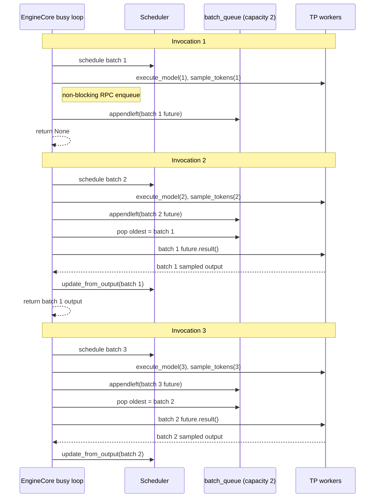

#### 10e.3. How the same request can be scheduled again

Autoregressive correctness is preserved even though EngineCore has not yet
received the previous token on the CPU.

After scheduling a batch, the async scheduler immediately advances
`num_computed_tokens`/`num_in_flight_tokens` and installs an output placeholder
for the token that batch will produce. This lets EngineCore schedule the next
position optimistically. On the worker, the sampled token remains in a device
tensor and is copied directly into the next batch's device input. It does not
need to make the round trip:

```text
XPU -> worker CPU -> EngineCore -> worker CPU -> XPU
```

The actual dependency remains ordered on the XPU stream:

```text
forward(N) -> sample(N) -> put sampled token N into input(N+1) -> forward(N+1)
```

The optimization removes the EngineCore/CPU round trip; it does not execute
`forward(N+1)` before `sample(N)`.

#### 10e.4. Where the overlap actually occurs

Every worker's Python RPC loop is sequential, and the XPU default stream also
preserves command order. The overlap is between different resources:

- EngineCore schedules and dispatches batch $N+1$ while batch $N$ is still
  completing.
- The worker CPU prepares/submits batch $N+1$ while the XPU executes commands
  previously submitted for batch $N$.
- The worker's async-output thread waits for sampled-token D2H completion while
  the worker main thread handles later RPCs.
- The separate output-copy stream can copy batch $N$ output while later default
  stream work executes, subject to device dependencies and copy-engine support.

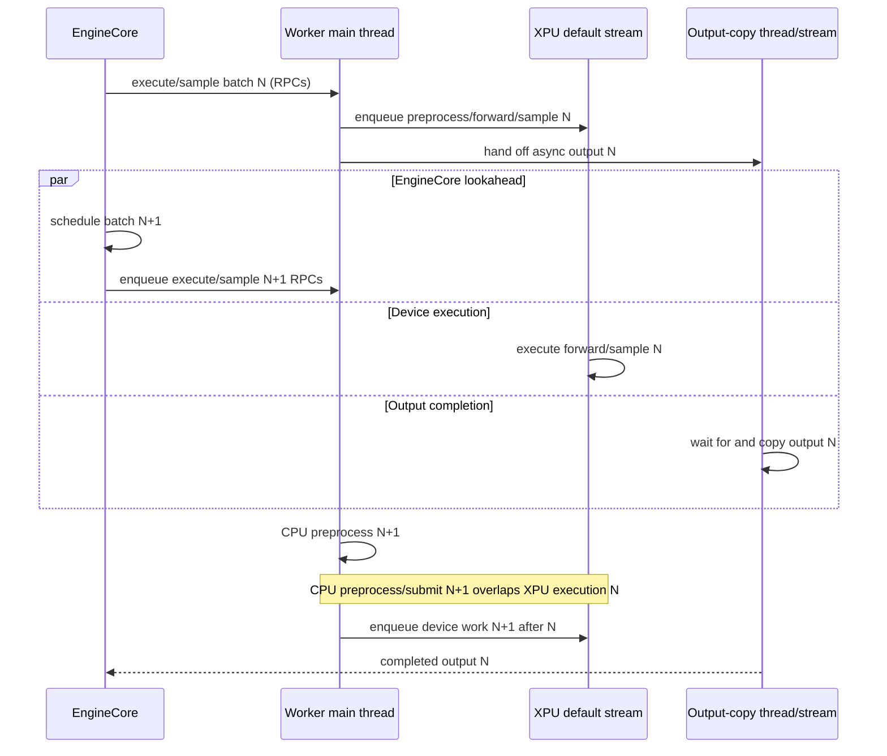

The device work on the default stream is generally serial:

```text
XPU: preprocess N -> forward N -> sample N -> preprocess N+1 -> forward N+1
```

What overlaps it is host work:

```text
CPU: submit N -----------------> preprocess/submit N+1 ---------------->
XPU:          preprocess/forward/sample N -> preprocess/forward N+1 -->
```

`synchronize_input_prep()` does not wait for the whole preceding model step. Its
event is recorded after the preceding asynchronous input transfer and before
that step's forward commands. The next invocation waits only until reused host
input buffers are safe, so its CPU preparation can proceed while the XPU is
still executing the preceding forward pass.

#### 10e.5. XPU graph replay limits the worker-side overlap

The timeline above is the maximum overlap available from the asynchronous batch
queue. With XPU graphs enabled, one runtime detail narrows it.

The model runner dispatches a graph using a `BatchDescriptor`, and
`CUDAGraphWrapper` caches one captured graph per descriptor. Steady-state decode
usually has the same padded token count, uniform-decode state, and LoRA state on
successive steps, so batch $N$ and batch $N+1$ normally select the **same graph
object**. At [cuda_graph.py:360](vllm/compilation/cuda_graph.py#L360), replay
enters this stack:

```text
entry.cudagraph.replay()
  -> torch.xpu.XPUGraph.replay()
  -> queue.ext_oneapi_graph(graph_exec)
  -> Unified Runtime Level Zero adapter
  -> zeEventHostSynchronize(previous submission of this command buffer)
```

Only `_model_forward()` is inside the captured graph. In this PP=1 Kimi-Linear
run, that graph is effectively

```text
embedding -> model layer 0 -> model layer 1 -> ... -> model layer N-1
```

Preprocessing GPU work is submitted before replay; logits/postprocessing GPU
work and the later sampling work are submitted after replay returns. Those
operations can therefore continue to be prepared and enqueued without waiting
merely because the graph object exists. On the default stream their device
execution remains ordered around the graph, but their asynchronous host
submission can overlap graph execution; independent streams may provide
additional overlap when their event dependencies permit it.

The worker main thread can run postprocessing/sampling for batch $N$ and prepare
batch $N+1$ while graph $N$ executes. Only when it reaches
`replay(graph N+1)` does the same-command-buffer rule apply: if graph $N$ is
still unfinished, the worker blocks until that graph submission completes.
Only then can it append the next replay. Therefore a repeatedly used full XPU
graph has at most **one active submission of that graph object**, while the
non-graph GPU operations before and after it can still proceed. The worker
cannot queue replay $N+1$ behind an unfinished replay $N$ as CUDA can with
`cudaGraphLaunch`.

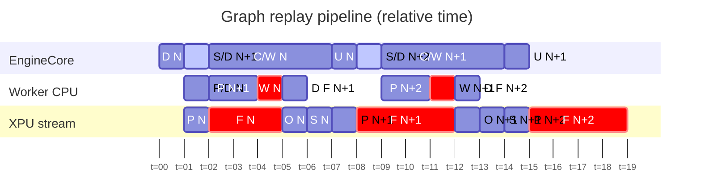

The compact labels expand as follows:

- **EngineCore:** `D` = dispatch; `S/D` = schedule and dispatch; `C/W` = collect
  and wait for the batch future; `U` = update the scheduler from the result.
- **Worker CPU:** `P/D` = preprocess and dispatch; `P` = preprocess the next
  batch; `W N` = wait for graph $N$ to finish; `D F` = dispatch the next forward
  graph. Thus `W N` precedes `D F N+1`, and `W N+1` precedes `D F N+2`.
- **XPU stream:** `P` = preprocess; `F` = captured forward graph; `O` =
  postprocess; `S` = sample.

The active EngineCore bar from $t=1$ to $t=2$ is
`queued_before_collect`: after dispatching $N$, EngineCore schedules and
dispatches $N+1$ before beginning collection of $N$. The chart shows the
blocking case on the worker: it preprocesses and dispatches batch $N$ from
$t=1$ to $t=2$, then preprocesses $N+1$ while forward graph $N$ executes. When
it tries to dispatch forward $N+1$ at $t=4$, `zeEventHostSynchronize` blocks it
until graph $N$ completes at $t=5$. The worker then dispatches forward $N+1$.
If graph $N$ has already completed, the red `W N` bar collapses to zero.
Forward $N+1$ still begins on the device only after the earlier default-stream
postprocess, sample, and preprocess operations complete.

The second half shows the pattern repeating: the worker prepares $N+2$ while
graph $N+1$ executes, waits if that graph is still active, and then dispatches
forward $N+2$. Meanwhile, EngineCore schedules $N+2$ before collecting $N+1$.

Based on the chart, the expected inter-token latency from the completed update
of $N$ at $t=8$ to the completed update of $N+1$ at $t=15$ is the sequential
critical path through `F N+1`, `O N+1`, `S N+1`, and `U N+1`:

$$
\mathrm{ITL}_{N+1}
\approx T_F(N+1) + T_O(N+1) + T_S(N+1) + T_U(N+1).
$$

In the illustrative timeline this is $4+1+1+1=7$ time blocks. `C/W N+1`
overlaps the XPU forward, postprocess, and sample work, so it is not added again
as an independent serial component; it completes when the corresponding result
becomes available for `U N+1`.

For two adjacent steps, let $T_{between}$ be the host time spent submitting
postprocessing/sampling for $N$ and preparing/submitting preprocessing for
$N+1$ before the next `replay()`. Let $T_{graph}$ be graph $N$'s execution time
available to overlap that work. The graph time hidden before the replay wait is
bounded by

$$T_{hidden} \le \min(T_{between}, T_{graph}),$$

and the residual same-graph host wait is approximately

$$T_{wait} = \max(0, T_{graph} - T_{between}).$$

Any graph time still remaining when the worker reaches `replay()` appears as a
host-side wait. Graph submission for $N+1$ itself cannot overlap the unfinished
submission of the same graph for $N$. This differs from graph-disabled eager
execution, where individual asynchronous kernel submissions may be queued while
earlier device work is still running. It also means the graph wait can be small
or already satisfied if the intervening postprocess, sample, and preprocess work
takes long enough for graph $N$ to finish before replay $N+1$ is attempted.

The impact by resource is:

| Potential overlap | XPU graph effect |
|---|---|
| EngineCore schedules $N+1$ while XPU executes $N$ | **Preserved.** EngineCore is a separate process; it can retain one-batch lookahead with queue capacity two. |
| Worker prepares inputs/metadata for $N+1$ while XPU executes $N$ | **Partially preserved.** Work before the replay call can overlap. |
| Preprocess, postprocess, and sample GPU operations proceed around the forward graph | **Preserved.** They are outside the captured `_model_forward()` command buffer. They can be asynchronously enqueued; default-stream ordering and data dependencies still determine when they execute. |
| Worker submits the same captured graph for $N+1$ while graph $N$ is unfinished | **Not available.** The UR adapter blocks the worker host on the preceding execution event. |
| XPU executes model work for $N$ and $N+1$ concurrently | **Not available.** Autoregressive dependencies and default-stream ordering already serialize these steps. |
| Output-copy thread/stream handles $N$ while later work proceeds | **Potentially preserved.** It is a separate host thread/stream, subject to event dependencies and copy-engine support. |
| A different captured graph object is replayed next | **The same-object wait does not apply.** Different `BatchDescriptor` entries own different command buffers, although normal stream/data dependencies can still serialize their device work. |

Thus `max_concurrent_batches=2` still provides **one batch of EngineCore
lookahead** (and transiently two outstanding batches), but it does not imply two
concurrent XPU graph executions. In steady-state decode that repeatedly selects
one graph, the practical gain is EngineCore work plus postprocess/sample and the
portion of next-step preprocessing completed before `replay()`; it is not
graph-to-graph device overlap. The wait is a current SYCL/Level Zero
command-buffer limitation, not an explicit synchronization added by PyTorch or
vLLM.

#### 10e.6. Structured-output exception

Normally `sample_tokens()` is dispatched immediately after `execute_model()`.
For structured output, the grammar mask for a new batch may depend on tokens
from the older in-flight batch. In that case `deferred_scheduler_output` is set,
and the invocation order becomes:

```text
dispatch execute_model(batch N)
collect and update batch N-1
compute the now-valid grammar mask
dispatch sample_tokens(batch N)
queue batch N's sampling future
```

This deliberately sacrifices some sampling overlap to preserve grammar
correctness.

### 10f. The TP=4 forward pass runs on all four XPU workers

For this configuration, `MultiprocExecutor.execute_model`
([multiproc_executor.py](vllm/v1/executor/multiproc_executor.py#L337)) is a
non-blocking `collective_rpc("execute_model", ...)`:

1. EngineCore broadcasts `SchedulerOutput` through `rpc_broadcast_mq`.
2. Every `WorkerProc` dequeues the same RPC and calls its local `XPUWorker`.
3. Each rank prepares its shard of model inputs and runs `GPUModelRunner` on its
  assigned XPU.
4. Tensor-parallel layers exchange partial tensors through oneCCL/XCCL
  collectives.
5. Worker replies return through the per-worker response queues. Only the
  designated output rank needs to return the model/sampling result to
  EngineCore; the other ranks still participate in all TP computation.

This repeats for prefill chunks and decode steps until each request reaches a
stop condition. Prefill may schedule many tokens in a step; ordinary decode
usually schedules one token per active request, or more with speculative
decoding.

### 10g. EngineCore sends incremental output back to APIServer

`_process_engine_step` receives the completed `{client_index:
EngineCoreOutputs}` mapping and puts each item on EngineCore's `output_queue`.
The `process_output_sockets` daemon thread msgpack-encodes each item and sends it
through the ZMQ `PUSH` socket to the APIServer's `PULL` socket.

Each `EngineCoreOutputs` batch can contain multiple per-request
`EngineCoreOutput` values. Important fields are:

- `request_id` — routes output to the correct frontend request state.
- `new_token_ids` — newly produced token IDs for this step.
- logprobs/prompt logprobs, when requested.
- `finish_reason` / `stop_reason` on the final output.
- scheduler and cache statistics.

In APIServer, `AsyncMPClient.process_outputs_socket`
([core_client.py](vllm/v1/engine/core_client.py#L1020)) decodes the ZMQ message
and places generation output onto its in-process `asyncio.Queue`.
`get_output_async()` waits on this queue; utility RPC replies are resolved
separately and do not enter normal generation processing.

### 10h. APIServer detokenizes and routes output to the HTTP request

`AsyncLLM._run_output_handler`
([async_llm.py](vllm/v1/engine/async_llm.py#L682)) is one background asyncio task
that handles outputs for all active requests:

1. `await engine_core.get_output_async()` gets the next decoded
  `EngineCoreOutputs` batch.
2. Large batches are split according to `VLLM_V1_OUTPUT_PROC_CHUNK_SIZE` so the
  event loop is yielded between chunks.
3. `OutputProcessor.process_outputs` looks up each `request_id`, appends token
  IDs, detokenizes incremental text, applies frontend stop-string handling,
  packages `RequestOutput`, and pushes it into that request's
  `RequestOutputCollector`.
4. Requests stopped by frontend text processing are asynchronously aborted in
  EngineCore.
5. Scheduler and Prometheus/stat-logger state is updated.

The request's `AsyncLLM.generate` coroutine wakes when its collector receives an
item and yields that `RequestOutput` to the OpenAI serving generator. Thus the
global output handler multiplexes EngineCore batches into independent async
streams—one stream per HTTP request.

### 10i. The OpenAI serving layer writes the response

#### Streaming (`stream=true`)

The route returns FastAPI `StreamingResponse(media_type="text/event-stream")`.
`chat_completion_stream_generator`
([serving.py](vllm/entrypoints/openai/chat_completion/serving.py#L431)) consumes
the `RequestOutput` stream and, for every update:

1. Converts incremental text/logprobs into
  `ChatCompletionStreamResponse`/choice deltas.
2. Runs reasoning and tool-call parsers when configured.
3. Serializes each chunk as server-sent events:

  ```text
  data: {"id":"chatcmpl-...","choices":[...],...}\n\n
  ```

4. Optionally emits usage information.
5. Ends the stream with:

  ```text
  data: [DONE]\n\n
  ```

Uvicorn/ASGI writes yielded chunks to the client socket and naturally applies
transport backpressure if the client reads slowly. The first token can therefore
be returned before the request has finished generating.

#### Non-streaming (`stream=false`)

`chat_completion_full_generator`
([serving.py](vllm/entrypoints/openai/chat_completion/serving.py#L888)) consumes
the same async `RequestOutput` stream to completion, keeps the final assembled
output, parses reasoning/tool calls, calculates usage, and returns one
`ChatCompletionResponse`. The route serializes it as `JSONResponse`; no HTTP body
is sent until generation finishes.

### 10j. Disconnects, aborts, and errors

If the client disconnects, FastAPI cancellation reaches the serving generator
and `AsyncLLM.generate`. Its cancellation handler calls `AsyncLLM.abort`, which:

1. Removes frontend state from `OutputProcessor`.
2. Sends `EngineCoreRequestType.ABORT` over ZMQ.
3. Causes EngineCore to call `scheduler.finish_requests(...,
  FINISHED_ABORTED)` and release request resources.

Validation errors become normal OpenAI `ErrorResponse` JSON. Streaming-time
generation errors are encoded as an SSE error event followed by `[DONE]`.
EngineCore death is forwarded through the client's output queue as
`EngineDeadError`, which fails active request streams and triggers server error
handling.

#### 10j.1. EOS and stop conditions with an in-flight next batch

Async scheduling makes a deliberate throughput/latency tradeoff: when batch
$N$ is collected, batch $N+1$ may already have been dispatched. Stop handling
therefore distinguishes conditions detectable in EngineCore from text-only
conditions detectable after frontend detokenization.

##### EOS and stop-token IDs

When `scheduler.update_from_output(batch N)` appends each sampled token, it calls
`check_stop()` before constructing `EngineCoreOutput`. The backend checks:

1. `min_tokens` (which suppresses stopping until the minimum is reached),
2. the model's EOS token ID,
3. configured `stop_token_ids`,
4. `max_tokens` and maximum model length,
5. optional repetition detection.

If batch $N$ contains EOS or a stop-token ID, the request becomes
`FINISHED_STOPPED`, is removed from the running scheduler set, and no batch
$N+2$ is scheduled. Batch $N+1$ has already been dispatched and generally
cannot be cancelled, so its result is drained later. At that point the scheduler
finds that the request is absent or already finished and ignores the result; it
does not create another `EngineCoreOutput`.

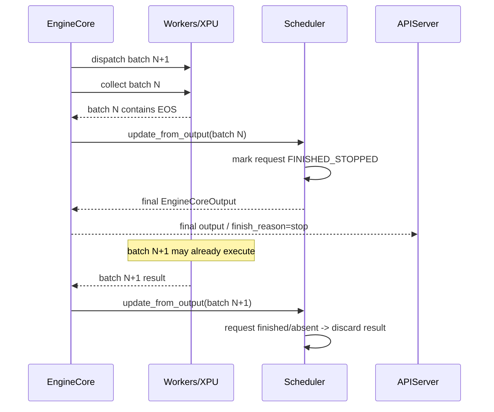

The stopping token remains part of backend request state. For a normal OpenAI
response, the frontend detokenizer suppresses the final EOS/stop token from
visible text unless `include_stop_str_in_output` requests otherwise. Tokens
after a stop found within a multi-token model output are trimmed before output
is emitted.

##### `max_tokens`

Unlike EOS, the length limit is predictable. `AsyncScheduler` includes
in-flight output placeholders in its length calculation and avoids scheduling a
step that is guaranteed to exceed `max_tokens`. The collected terminal step is
still marked `FINISHED_LENGTH_CAPPED`, but an unnecessary extra step can usually
be prevented rather than discarded afterward.

##### Textual stop strings

Arbitrary stop strings can cross token boundaries, so they are detected in the
APIServer's incremental detokenizer rather than in EngineCore:

```text
EngineCore emits token IDs
  -> APIServer detokenizes incremental text
  -> stop string matches
  -> visible text is truncated according to include_stop_str_in_output
  -> OutputProcessor queues an ABORT for EngineCore
  -> scheduler marks the request FINISHED_ABORTED
```

This path includes an EngineCore-to-APIServer-to-EngineCore ZMQ round trip. The
batch queue bounds the number of outstanding batches at any instant, but the
busy loop can complete and dispatch additional batches before the abort message
arrives. Those results are ignored after the abort and are never exposed as
additional user-visible text.

##### Safe KV-cache reclamation

Finishing a request cannot immediately recycle blocks that an already-dispatched
batch may still access. Async scheduling records a scheduling sequence fence on
the request. `_free_request_blocks()` moves such blocks to `deferred_frees`, and
`_drain_deferred_frees()` returns them to the pool only after the corresponding
GPU step has been processed. This prevents the stale batch from writing into KV
blocks reassigned to another request.

| Stop source | Detection location | Possible extra work | User-visible extra output |
|-------------|--------------------|---------------------|---------------------------|
| EOS token | EngineCore scheduler | Normally one already-dispatched batch | No |
| `stop_token_ids` | EngineCore scheduler | Normally one already-dispatched batch | No |
| `max_tokens` | Async scheduler length accounting | Usually prevented | No |
| Text stop string | APIServer detokenizer | May continue until abort reaches EngineCore | No |
| Client disconnect/abort | APIServer | Already-dispatched work is drained/ignored | No |

### 10k. Complete steady-state sequence

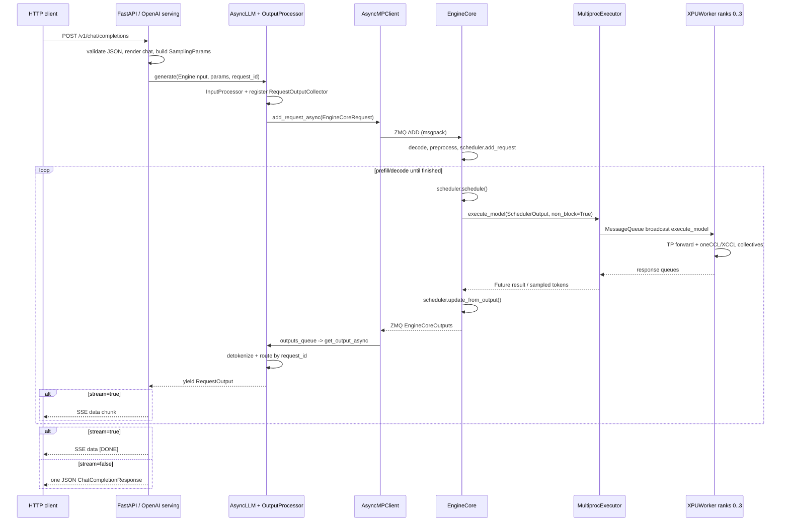

---

## 11. End-to-End Summary

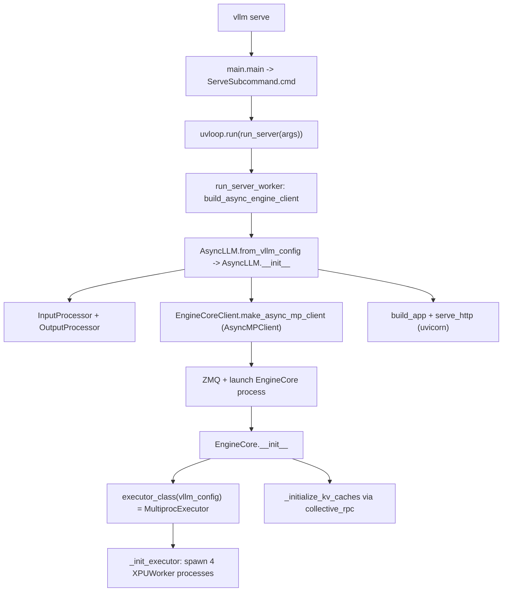

**Key takeaways**

1. `vllm serve` is a console script → `main()` → `ServeSubcommand.cmd` →
   `uvloop.run(run_server(...))`. `uvloop.run` just runs a coroutine on a new event
   loop in the current thread; it does **not** create processes/threads.
2. `AsyncLLM.from_vllm_config` is a factory that resolves the executor class and
   translates args before the constructor runs.
3. The **API server**, **EngineCore**, and **workers** are separate OS processes.
4. Three IPC layers: **ZMQ** (API↔EngineCore), **shared-memory MessageQueue**
   (EngineCore↔workers), **torch.distributed collectives** (worker↔worker).
5. `self.model_executor = executor_class(vllm_config)` is the line that brings up
   the whole 4-GPU worker fleet and blocks until all workers report `READY`.
